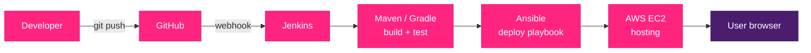

<p align="center">
  
</p>

<p align="center">
  
  
  
  
  
  
  
  
</p>

---

## 🌸 Overview

A web app that turns three inputs into a personalised cycle tracker:

| Input | Example |
|-------|---------|
| Date of last period | `2026-09-11` |
| Period length | `8 days` |
| Cycle length | `25 days` |

**Output:** a colour-coded 3-month calendar, upcoming cycle table, and a printable report.

> Built as a hands-on DevOps project: the app is small on purpose, so the focus is on the pipeline around it.

---

## 💗 Features

- Next period and peak ovulation prediction
- 3-month calendar with previous / next navigation
- Upcoming cycles table (next 6 cycles)
- Print-friendly report
- Responsive layout and dark mode
- Privacy first: data stays in the user's browser (`localStorage`)

---

## 🎀 Calendar logic

For a cycle starting on day `S`, with period length `L` and cycle length `C`:

| Phase | Colour | Days |
|-------|--------|------|
| Period | 🩷 Pink | `S` to `S + L - 1` |
| Post period | 🟣 Purple | `S + L` to `S + L + 1` |
| Peak ovulation | 🟢 Green | `S + L + 2` to `S + L + 6` |
| Pre-period | 🟡 Yellow | `S + C - 2` to `S + C - 1` |

Next cycle start = `S + C`.

---

## 🏗️ Architecture



---

## 🧰 Tech stack

| Layer | Tool | Purpose |
|-------|------|---------|
| Frontend | HTML, CSS, JavaScript | Tracker UI and calendar |
| Backend *(planned)* | Java, Spring Boot | Cycle calculation REST API |
| Build | Maven, then Gradle | Compile, test, package |
| Version control | Git, GitHub | Source control and branching |
| CI/CD | Jenkins | Automated build, test, deploy |
| Config management | Ansible | Repeatable server deployment |
| Cloud | AWS EC2 | Hosting |

---

## 📁 Project structure

```
period-tracker/
├── frontend/        # tracker web page
├── backend/         # Spring Boot API (planned)
├── ansible/         # playbooks and inventory (planned)
├── Jenkinsfile      # pipeline as code (planned)
└── README.md
```

---

## 🚀 Run locally

```bash
git clone https://github.com/ChristinaRajakumari2005/period-tracker.git
cd period-tracker/frontend
# open index.html in your browser
```

---

## 🗺️ Roadmap

- [x] Frontend tracker page
- [ ] Spring Boot backend with Maven
- [ ] Gradle build
- [ ] AWS EC2 server setup
- [ ] Ansible deployment playbook
- [ ] Jenkins CI/CD pipeline
- [ ] Optional: Docker, S3 + CloudFront

---

## ⚠️ Disclaimer

This tool gives estimates based on user input. It is not a medical tool and must not be used for birth control. Consult a doctor for health concerns.

---

<p align="center">
  Built by <b>Christina Rajakumari</b> 🌸
</p>

<p align="center">
  
</p>
